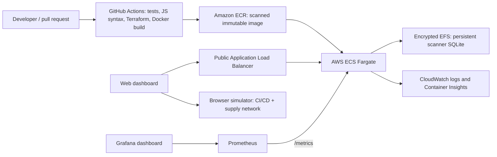

# SupplyGuard Cloud Delivery Simulator

## தமிழில்: ஆரம்பம் முதல் இயக்குவது வரை

இந்த வழிகாட்டி Windows PowerShell-ல் திட்டத்தை download/checkout செய்ததிலிருந்து simulator-ஐ browser-ல் திறப்பது வரை விளக்குகிறது. Linux/macOS கட்டளைகளும் கீழே உள்ளன.

### 1. தேவையான மென்பொருள்

- Windows 10/11, macOS, அல்லது Linux
- Python 3.10 அல்லது அதற்கு மேல் (இந்த project-ன் FastAPI backend-ஐ இயக்க)
- Git (project-ஐ clone செய்ய வேண்டுமெனில்)
- நவீன browser: Chrome, Edge, Firefox, அல்லது Safari
- Internet இணைப்பு: முதல் முறையாக Python packages நிறுவவும், Google Fonts ஏற்றவும் மட்டும் தேவை. Simulator-க்கு cloud account, API key, அல்லது paid service தேவையில்லை.

Python இருக்கிறதா என்று PowerShell-ல் பார்க்கவும்:

```powershell
py --version
```

`Python 3.10.x` அல்லது அதைவிட புதிய பதிப்பு வர வேண்டும். `py` கிடைக்கவில்லை என்றால் Python-ஐ நிறுவி, installer-ல் PATH விருப்பத்தை இயக்கவும். `py`-க்கு பதிலாக `python` கட்டளையையும் பயன்படுத்தலாம்.

### 2. Project folder-க்கு செல்லவும்

Project ஏற்கனவே உங்கள் கணினியில் இருந்தால் அதன் folder-க்கு செல்லவும்:

```powershell
cd D:\KARUNYA\Projects\supplyguard
```

வேறு இடத்தில் clone செய்ய வேண்டுமெனில்:

```powershell
git clone <repository-url> supplyguard
cd supplyguard
```

`repository-url`-ஐ உங்கள் Git repository முகவரியால் மாற்றவும். Folder-ல் `run.py`, `requirements.txt`, `backend`, `frontend` ஆகியவை இருப்பதை உறுதிசெய்யவும்:

```powershell
Get-ChildItem
```

### 3. Python virtual environment அமைக்கவும்

```powershell
py -m venv .venv
.\.venv\Scripts\Activate.ps1
```

சரியாக activate ஆன பிறகு command prompt-ல் `(.venv)` தெரியும். PowerShell script execution தடுக்கப்பட்டால், இந்த PowerShell window-க்கு மட்டும் அனுமதிக்கவும்:

```powershell
Set-ExecutionPolicy -Scope Process -ExecutionPolicy Bypass
.\.venv\Scripts\Activate.ps1
```

### 4. Dependencies நிறுவவும்

Virtual environment activate ஆன நிலையில்:

```powershell
python -m pip install --upgrade pip
pip install -r requirements.txt
```

இது FastAPI/Uvicorn backend, SQLite தொடர்பான code, authentication, மற்றும் scanner-க்கு தேவையான Python packages-ஐ நிறுவும். Frontend-க்கு `npm install` தேவையில்லை; இது browser-ல் இயங்கும் JavaScript/CSS.

### 5. Configuration (விருப்பம்)

Simulator-ஐ இயக்க `.env` file கட்டாயமில்லை. Project-ல் ஏற்கனவே `.env` இருந்தால் அதை மாற்றாமல் வைத்திருக்கவும். புதிய local configuration உருவாக்க:

```powershell
Copy-Item .env.example .env
```

`.env`-ல் `APP_NAME`, `SECRET_KEY`, `TOKEN_EXPIRE_MINUTES`, `DATABASE_PATH`, `CORS_ORIGINS` அமைக்கலாம். Simulator இவற்றில் cloud credential எதையும் பயன்படுத்தாது. Optional Project Scanner-ஐ account-களுடன் பயன்படுத்தினால், local development-க்கும் `SECRET_KEY`-ஐ தனிப்பட்ட நீளமான random value-ஆக மாற்றவும்; உண்மையான secrets-ஐ repository-ல் commit செய்ய வேண்டாம்.

### 6. Application-ஐ இயக்கவும்

Project root-ல் இருந்து:

```powershell
python run.py
```

Terminal-ல் server எந்த bind address மற்றும் port-ல் இயங்குகிறது என்று வரும். `0.0.0.0` என்பது server bind செய்யும் wildcard address; அதை browser URL-ஆக திறக்க வேண்டாம். அதற்குப் பதிலாக, அதே கணினியில் `http://127.0.0.1:5050/` திறக்கவும். `PORT` environment variable அமைத்திருந்தால் அந்த port-ஐ பயன்படுத்தவும்:

- Simulator: <http://127.0.0.1:5050/>
- API health: <http://127.0.0.1:5050/api/health>
- API documentation: <http://127.0.0.1:5050/docs>

முதல் startup-ல் SQLite database உருவாக்கப்பட்டு தேவையான schema/policy data initialize ஆகும். Simulator login இல்லாமல் நேரடியாக திறக்கும். Overview-இல் **Start simulation** அல்லது **CI/CD Simulator**-இல் scenario தேர்ந்தெடுத்து **Run pipeline** அழுத்தவும். Pipeline stages மாறி, logs மற்றும் metrics புதுப்பித்து, முடிவில் success/failure summary காட்டும். எல்லா cloud செயல்பாடுகளும் mock simulation மட்டுமே.

இயக்கத்தை நிறுத்த terminal-க்கு திரும்பி `Ctrl+C` அழுத்தவும். பின்னர் மீண்டும் தொடங்க அதே `python run.py` கட்டளையை இயக்கவும்.

### 7. விருப்பம்: Docker மூலம் இயக்குதல்

Docker Desktop நிறுவி திறந்திருக்க வேண்டும். Project root-ல்:

```powershell
docker compose up --build
```

பிறகு <http://127.0.0.1:5050/> திறக்கவும். நிறுத்த `Ctrl+C`; containers-ஐ நிறுத்தி அகற்ற:

```powershell
docker compose down
```

SQLite data `supplyguard-data` volume-ல் இருக்கும். Docker-ஐப் பயன்படுத்தினால் Python virtual environment அமைக்க வேண்டியதில்லை.

### Linux / macOS விரைவு கட்டளைகள்

```bash
cd /path/to/supplyguard
python3 -m venv .venv
source .venv/bin/activate
python -m pip install --upgrade pip
pip install -r requirements.txt
python run.py
```

### Optional Project Scanner

Cloud simulator-ஐப் பயன்படுத்த scanner account தேவையில்லை. Project Scanner என்பது ஏற்கனவே உள்ள authenticated backend feature. Account உருவாக்க அல்லது sign-in செய்ய API documentation-ஐத் திறந்து `POST /api/auth/register` அல்லது `POST /api/auth/login` பயன்படுத்தலாம். API access token-ஐ `Authorization: Bearer <token>` header-ல் அனுப்ப வேண்டும். Browser app-ல் account token ஏற்கனவே இருந்தால் scan history காட்டப்படும். Folder scan CLI-யையும் பயன்படுத்தலாம்:

```powershell
python cli_scanner.py .\path\to\project
python cli_scanner.py .\path\to\project --json
```

### பொதுவான பிழைகள் மற்றும் தீர்வுகள்

| பிழை / அறிகுறி | காரணம் | சரிபார்த்து சரிசெய்வது |
|---|---|---|
| `py` அல்லது `python` command கிடைக்கவில்லை | Python நிறுவப்படவில்லை அல்லது PATH-ல் இல்லை | Python 3.10+ நிறுவி புதிய terminal திறக்கவும்; `python --version` பார்க்கவும். |
| `Activate.ps1 cannot be loaded` | PowerShell execution policy script-ஐத் தடுக்கிறது | மேலே உள்ள `Set-ExecutionPolicy -Scope Process -ExecutionPolicy Bypass` கட்டளையை அதே window-ல் இயக்கி activate செய்யவும். |
| `No module named fastapi` / `uvicorn` | Dependencies சரியான environment-ல் நிறுவப்படவில்லை | `.venv` activate ஆனதா பார்க்கவும்; `python -m pip install -r requirements.txt` மீண்டும் இயக்கவும். |
| `Could not find a version that satisfies...` அல்லது pip download error | Python பதிப்பு பழையது, இணையம்/proxy சிக்கல் | `py --version` பார்க்கவும்; Python 3.10+ பயன்படுத்தி, இணைய இணைப்பு/proxy அமைப்பைச் சரிபார்க்கவும். |
| `Address already in use` / port 5050 busy | வேறு process ஏற்கனவே 5050-ல் இயங்குகிறது | பழைய server terminal-ல் `Ctrl+C` செய்யவும்; அல்லது `run.py`-ல் port மாற்றி அதே port-ஐ browser-ல் திறக்கவும். |
| `localhost:5050` திறக்கவில்லை | Server தொடங்கவில்லை அல்லது தவறான folder-ல் கட்டளை இயக்கப்பட்டது | Terminal error-ஐப் படிக்கவும்; `Get-Location` மூலம் project root உறுதிசெய்து `python run.py` மீண்டும் இயக்கவும். |
| API `500` / database error | `.env`-ல் தவறான `DATABASE_PATH`, folder permission, அல்லது SQLite file சிக்கல் | `.env` path சரியா, folder எழுத அனுமதிக்கிறதா பார்க்கவும். முக்கிய scan data இருந்தால் DB-ஐ நீக்க வேண்டாம்; முதலில் backup எடுக்கவும். |
| Login `401` / token invalid (Scanner மட்டும்) | தவறான/காலாவதியான token அல்லது `SECRET_KEY` மாறியுள்ளது | `/docs`-ல் மீண்டும் login செய்து token பெறவும். Simulator-க்கு login தேவையில்லை. |
| Docker command கிடைக்கவில்லை / daemon error | Docker Desktop நிறுவப்படவில்லை அல்லது இயங்கவில்லை | Docker Desktop-ஐ நிறுவி திறந்து, `docker compose up --build` மீண்டும் இயக்கவும். |
| Browser-ல் பழைய UI தெரிகிறது | Cache செய்யப்பட்ட static files | `Ctrl+F5` அழுத்தி hard refresh செய்யவும்; server-ஐ restart செய்து மீண்டும் திறக்கவும். |

பிழையை கண்டறிய முதலில் `python run.py` இயக்கிய அதே terminal-ல் வரும் traceback-ஐப் பாருங்கள். கடைசி சில error வரிகள் பொதுவாக காரணத்தையும் எந்த module/file-ல் ஏற்பட்டது என்பதையும் காட்டும். Health endpoint பதில் தருகிறதா என `http://localhost:5050/api/health` திறந்து backend நிலையைத் தனியாகச் சரிபார்க்கலாம்.

SupplyGuard is a local, cloud-native learning simulator for three connected practices: CI/CD, DevOps operations, and software supply-chain security. It models a change moving from commit through build, tests, policy gates, artifact signing, and deployment, then surfaces the effect in environment health and monitoring views.

All cloud infrastructure, scan results, deployment actions, signatures, provenance, alerts, and metrics in the simulator are **mock data**. The browser app provisions no resources and needs no cloud account, cloud credentials, paid service, authentication, or frontend build step. The existing optional project scanner is backed by the local FastAPI service and still requires an account to store scan history.

## Run locally

Requires Python 3.10 or newer.

```bash
python -m venv .venv
# Windows PowerShell: .venv\Scripts\Activate.ps1
# macOS/Linux: source .venv/bin/activate
pip install -r requirements.txt
python run.py
```

The local runner binds to `127.0.0.1` by default and prints the correct browser URL. Open <http://127.0.0.1:5050/> (or use the printed URL if `PORT` is set). `0.0.0.0` is for binding a service to all interfaces; it is not the address to enter into a browser. For Docker or a remote host, bind with `APP_HOST=0.0.0.0` and open the host's reachable name/IP and published port. The cloud simulator opens directly without signing in. To use the optional project scanner, register/sign in through the API at <http://127.0.0.1:5050/docs>, then open **Project Scanner** in the console.

## Docker

```bash
docker compose up --build
```

Open <http://127.0.0.1:5050/> (or `http://127.0.0.1:<PORT>/` when `PORT` is set). Docker binds Uvicorn to `0.0.0.0` inside the container and publishes that port to the host. SQLite data is persisted in the `supplyguard-data` Docker volume.

## GitHub Codespaces cloud development

`.devcontainer/devcontainer.json` prepares a Python 3.12 Codespace, installs the project dependencies, includes Docker Compose support for the complete monitoring stack, and forwards the app, Prometheus, and Grafana ports. Push this project to a GitHub repository, then choose **Code → Codespaces → Create codespace on main**. After setup, start either the lightweight app or the full stack:

```bash
python run.py
# Or, in another terminal, run the app plus Prometheus and Grafana:
docker compose up --build -d
```

Codespaces automatically forwards port 5050 and opens the dashboard. Use the address shown in the **Ports** tab; the in-container bind address `0.0.0.0` is never a browser URL. Prometheus and Grafana use forwarded ports 9090 and 3000. Add `SECRET_KEY` as a Codespaces secret (Repository settings → Secrets and variables → Codespaces) if you use scanner authentication. Do not put credentials in `devcontainer.json` or commit them. For hot reload, run `APP_RELOAD=true python run.py` in the Codespaces terminal.

## Simulator guide

- **Overview** — platform health, delivery pipeline, recent activity, infrastructure health, and security posture.
- **CI/CD Simulator** — choose a scenario and speed, then run, pause/resume, retry, cancel, and inspect stage logs and the run summary.
- **DevOps Environments** — compare Development, Testing, Staging, and Production health; explore rolling, blue-green, and canary strategies; trigger an incident.
- **Supply Chain Security** — inspect mock vulnerability findings, remediation suggestions, an SBOM, scan coverage, artifact signing, and provenance; simulate a blocked untrusted package.
- **Deployments** — inspect deployment history and simulate deployment or rollback actions.
- **Monitoring** — view request, latency, error, uptime, service, and alert signals. The incident control feeds into these signals.
- **Logs** — inspect pipeline events or export the current run's logs.
- **Cloud Architecture** — follow the simulated source-to-production system and rollback path.
- **Settings** — adjust the simulation speed and inspect local simulator configuration.

Available pipeline scenarios are successful deployment, build failure, test failure, security vulnerability, supply-chain attack, deployment rollback, and infrastructure incident. Simulation speed and progress are held in browser memory/local settings; the mock pipeline itself is deterministic by scenario, with sample telemetry variation.

## Architecture

The project keeps its existing FastAPI service and optional authenticated scanner. The simulator is a modular browser application served by FastAPI as static files:

```text
frontend/
  index.html          App mount point
  css/styles.css      Responsive cloud-console styling
  js/app.js           Navigation, views, rendering, and UI interactions
  js/simulation.js    Mock pipeline state machine and scenario outcomes
backend/
  main.py             FastAPI routes and static app hosting
  scanner_engine.py   Existing local project-file scanner
  policy_engine.py    Existing scanner policy evaluation
database/             SQLite schema and seed policies
tests/                Existing backend/scanner tests
```

Main simulation models are pipeline stages and execution state, environment health metrics, vulnerability and SBOM package records, deployment events, incidents, and activity/log entries. The simulation engine advances through seven pipeline stages on a speed-controlled timer, emits a log/event for each stage, updates mock telemetry, and applies scenario-specific failure or success summaries. It has no external API dependency.

## Digital supply network simulator

The **Supply Network Simulator** is a separate live module for physical/digital fulfillment workflows. It tracks SKU on-hand/reserved/reorder quantities, suppliers and risk scores, shipment destinations and ETAs, on-time fulfillment, and a live event stream. It runs on a browser timer and remains usable independently of the CI/CD simulation. Use the controls to simulate stock shortage, shipment delay, supplier disruption, replenishment, pause/resume, and reset. All values are sample data and reset locally.

## Architecture and DevOps stack



The local Compose stack runs the app, Prometheus, and Grafana without AWS credentials. Terraform provides an optional AWS deployment using ECR, an Application Load Balancer, ECS Fargate, CloudWatch, and encrypted EFS. Kubernetes manifests are an alternative deployment target. Cloud resources are not created by local simulation. AWS resources such as ALB, Fargate, EFS, and data transfer can incur charges; destroy the Terraform stack when finished.

### Start the complete local demo

Copy `.env.example` to `.env` if it does not already exist, then run:

```powershell
docker compose up --build -d
docker compose ps
```

Open:

- App: <http://127.0.0.1:5050/>
- Prometheus: <http://127.0.0.1:9090/>
- Grafana: <http://127.0.0.1:3000/> (local demo login `admin` / `supplyguard-demo`, change via `GRAFANA_PASSWORD`)

Grafana provisions the SupplyGuard Prometheus datasource and dashboard automatically. To follow service logs use `docker compose logs -f supplyguard`; stop the stack with `docker compose down`. Use `PORT`, `PROMETHEUS_PORT`, or `GRAFANA_PORT` to select different host ports. The frontend is also runnable without Docker using the Python steps above; Prometheus/Grafana are available in the Compose stack.

### Kubernetes

`infra/kubernetes/` contains Namespace, Deployment, Service, Ingress, and persistent volume claim manifests. Copy `secret.example.yaml` to `secret.yaml`, set a real random scanner `SECRET_KEY`, replace the placeholder image and ingress hostname, then follow [the Kubernetes deployment guide](infra/kubernetes/README.md). Do not commit the filled secret file. The app binds to `0.0.0.0` in its container; use `kubectl port-forward` or the configured ingress address in the browser, never `0.0.0.0`.

### AWS deployment with Terraform

The AWS stack is opt-in and requires AWS CLI credentials with permissions to create VPC/networking, ECR, ECS, IAM, ALB, EFS, and CloudWatch resources. Create a Secrets Manager secret whose JSON has a `SECRET_KEY` property. Bootstrap the immutable ECR repository, build/push an image, then apply the stack:

```bash
cd infra/terraform
terraform init
terraform apply -target=aws_ecr_repository.app -var='container_image=bootstrap' -var='app_secret_arn=arn:aws:secretsmanager:us-east-1:123456789012:secret:supplyguard'
```

Use the `ecr_repository_url` output to tag and push the project container:

```bash
aws ecr get-login-password --region us-east-1 | docker login --username AWS --password-stdin <ACCOUNT_ID>.dkr.ecr.us-east-1.amazonaws.com
docker build -t <ECR_REPOSITORY_URL>:initial .
docker push <ECR_REPOSITORY_URL>:initial
terraform apply -var='container_image=<ECR_REPOSITORY_URL>:initial' -var='app_secret_arn=<SECRET_ARN>'
terraform output -raw application_url
```

Replace all angle-bracket placeholders with the actual account, image, and secret values. If using HTTPS, create an ACM certificate in the same region and pass `-var='certificate_arn=<ACM_CERTIFICATE_ARN>'`; the ALB then redirects HTTP to HTTPS. Restrict `allowed_cidr` from its demo default for a limited audience. Run `terraform destroy` after the demo to remove the billable stack. Do not store credentials or Terraform state in Git.

### CI/CD automation

- `.github/workflows/ci-supply-chain.yml` runs backend tests, JavaScript syntax checks, Terraform formatting/validation, Compose config validation, and a container build for pushes and pull requests.
- `.github/workflows/deploy-aws.yml` is a manual `workflow_dispatch` deployment. It uses GitHub OIDC, publishes a commit-SHA-tagged immutable image to ECR, applies Terraform, and prints the resulting application URL to the job summary. Configure GitHub secret `AWS_ROLE_ARN`, secret `APP_SECRET_ARN`, an AWS OIDC trust role scoped to this repository, and bootstrap the ECR repository/stack first. No AWS credentials are committed to the project.

## Demo walkthrough

Public demo: <https://supplyguard-cloud-simulator.vercel.app/>. The hosted static dashboard includes the browser-based CI/CD and digital supply-network simulations. The project scanner API and Prometheus/Grafana are part of the local/container deployment and are not exposed by this static demo. Run the full local stack below to use those services.

Follow the [walkthrough outline](docs/demo-walkthrough.md) for a concise recording sequence covering the pipeline, supply network, monitoring, and deployment views. This is a recording script; a video file is not included.

## Optional project scanner

The original scanner checks submitted project files for likely hard-coded credentials, dependency versioning risks, missing lock files, invalid `package.json`, and basic Dockerfile hardening issues. Its API documentation is at <http://localhost:5050/docs>.

```bash
python cli_scanner.py ./path/to/project
python cli_scanner.py ./path/to/project --json
```

Scanner uploads are limited to 500 files and 5 MB of UTF-8 contents. File contents are scanned in memory; the service stores findings and metadata. These lightweight local checks do not replace a full secret scanner or vulnerability database.

## Configuration and API

Copy `.env.example` to `.env` to configure `APP_NAME`, `SECRET_KEY`, `TOKEN_EXPIRE_MINUTES`, `DATABASE_PATH`, `CORS_ORIGINS`, `APP_HOST`, `APP_PORT`, and `APP_RELOAD`. Local defaults are `APP_HOST=127.0.0.1`, `APP_PORT=5050`, and `APP_RELOAD=false`; a platform-provided `PORT` overrides `APP_PORT`. Containers set `APP_HOST=0.0.0.0` so Docker can publish the service port. Use `0.0.0.0` only as a server bind address; browse to `127.0.0.1`, the host's reachable IP, or its DNS name. The simulator itself does not use secrets. API routes include `/api/health`, `/api/auth/register`, `/api/auth/login`, `/api/auth/me`, `/api/policies`, and `/api/scans`.

## CI

The GitHub Actions workflow in `.github/` runs the backend checks on pushes and pull requests.
